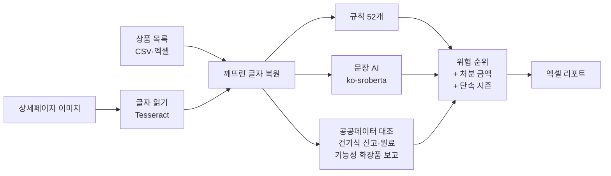
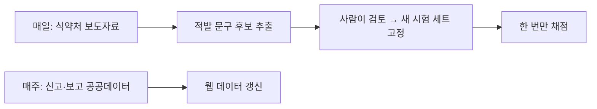

# 문구레이더 (precheck-ai)

[](https://github.com/ojg1476-tech/precheck-ai/actions/workflows/tests.yml)

> **화장품·식품·건강기능식품 셀러의 상품 수십~수백 개를 한 번에 검사해, 식약처에 걸릴 위험이 큰 상품부터 알려 주는 광고 문구 점검 도구**

**[▶ 바로 써보기](https://moonguradar.vercel.app/)** · 파일이 없어도 ‘예시로 해보기’로 볼 수 있어요 · 올린 파일은 브라우저 밖으로 나가지 않아요

| 처음 보는 실제 적발 문구 118개 | 신고 제품 대조 | 브라우저 안에서만 | 자동 갱신 |
| :---: | :---: | :---: | :---: |
| 금칙어 목록 **32%** → 문구레이더 **78%** | 건강기능식품 **45,485개**<br>기능성 화장품 **197,548건** | 검사·AI·이미지 글자 읽기<br>모두 서버 없이 | 단속 소식 매일<br>공공데이터 매주 |

> 이 도구는 광고 점검을 돕는 참고 자료이며 법률 판단이 아니에요.

---

## 이 프로젝트로 보여주고 싶은 것

데이터 분석을 공부하며 **문제 정의 → 데이터 수집 → 모델·규칙 → 정직한 평가 → 실제 서비스**까지 혼자 끝까지 해 본 프로젝트예요.

| | 한 일 | 근거 |
| --- | --- | --- |
| **1. 데이터로 문제 정의** | 식약처 단속 데이터를 먼저 분석하고, ‘그냥 AI’와 비교 실험을 해 보니 문구 한 줄 판단은 무료 AI도 잘했어요. 그래서 방향을 **많은 상품을 같은 기준으로, 위험한 순서대로**로 바꿨어요. | [단속 데이터 분석](#식약처-단속-데이터에서-출발) · [AI 비교 실험](#그냥-ai-챗봇과-무엇이-다른가) |
| **2. 부풀리지 않는 평가** | 시험 세트를 규칙을 고치기 **전에 커밋해 고정**하고 한 번만 쟀어요. 이미 본 데이터로 잰 숫자는 ‘참고용’으로 따로 적었어요. | [성능](#성능) · [실험 기록](eval/history.md) |
| **3. 공공데이터 결합** | 식품안전나라·공공데이터포털의 신고·보고 자료 24만여 건을 받아, 원고의 효능 표현을 **그 제품이 실제로 신고한 기능**과 대조해요. | [공공데이터 대조](#공공데이터-대조) |
| **4. 자동화 파이프라인** | GitHub Actions로 식약처 보도자료 매일 수집 → 새 적발 문구 후보 추출, 신고 자료 매주 갱신, 테스트·AI 학습·평가 자동 실행 | [`.github/workflows/`](.github/workflows) |
| **5. 실제 서비스** | 웹 배포(Vercel), 익명 사용 집계(GoatCounter), 크몽에 점검 서비스 등록 | [moonguradar.vercel.app](https://moonguradar.vercel.app/) · [크몽](https://kmong.com/gig/848274) |

---

## 왜 필요한가

- **단속이 늘고, 계정 단위로 무더기로 나와요.** 식품 온라인 부당광고 적발은 2024년 10,033건 → 2025년 14,254건(+42%), 적발 계정 1곳당 평균 3.6건이에요.
- **플랫폼 제재도 단계적으로 무거워져요.** 반복 적발 시 판매 중단 → 신규 등록 제한 → 계정 정지.
- **그런데 기존 검수는 상품 1개 단위예요.** 건당 3만~15만 원이라 상품이 100개면 300만 원이 넘어요. 상품이 많은 셀러일수록 점검을 안 받게 돼요.

---

## 주요 기능

| 기능 | 하는 일 |
| --- | --- |
| 📋 **일괄 점검** | CSV·엑셀 상품 목록을 올리면 모든 상품을 검사해 **위험 순위표**와 **엑셀 리포트**(고칠 곳·확인할 것·처분·대신 쓸 문구)를 만들어요 |
| 🔎 **규칙 52개 + AI** | 식약처 기준으로 만든 규칙에, 실제 적발 문구 399개로 학습한 한국어 문장 AI(ko-sroberta)를 더해 처음 보는 말투도 잡아요 |
| 🧾 **공공데이터 대조** | 건강기능식품은 신고한 기능성, 기능성 화장품은 보고한 기능과 원고를 맞춰 봐요 |
| 🖼️ **이미지 글자 읽기** | 상세페이지가 이미지면 무료 Tesseract로 글자를 읽어 검사해요 (API 키가 있으면 Claude) |
| 🔤 **깨뜨려 쓴 글자** | ‘다.이.어.트’, ‘면♡역력’, ‘ㄷㅣ톡스’처럼 단속을 피하려 쪼갠 표현도 붙여서 다시 검사해요 |
| 📣 **광고·협찬 표시** | ‘내돈내산’, ‘체험단’, ‘무상으로 제공받아’ 같은 추천·보증 표시 문제를 알려 줘요 |
| 💸 **처분을 돈으로** | 1차 위반 처분 기간 × 하루 매출로 **적발되면 잃는 금액**을 보여 줘요 |
| 📅 **단속 시즌·최신 소식** | 과거 점검 발표로 만든 1년 단속 달력, 상품별 다가오는 단속 시즌, 식약처 보도자료 매일 수집 |

**위험도:** 🔴 높음(꼭 고칠 표현) → 🟠 중간(확인 필요) → 🔵 확인(자료 필요) → 🟢 양호. 같은 위험도에서는 처벌이 무거운 상품이 먼저 와요.

---

## 차별점

### 다른 방법과 비교

| | 금칙어 검사기 | 그냥 AI 챗봇 | 크몽 검수 서비스 (10곳 조사) | **문구레이더** |
| --- | :---: | :---: | :---: | :---: |
| 한 번에 검사하는 단위 | 문장 | 페이지 1개 | 상세페이지 1개·문장 수 | **상품 목록 전체** |
| 위험한 상품부터 정렬 | ✗ | ✗ | ✗ | **✓** |
| 처음 보는 적발 문구 탐지 | 32% | 잘함 | 공개 안 함 | **78%** |
| 처벌 정보의 출처 | ✗ | 지어낼 수 있음 | 사람마다 다름 | **원문 확인한 표에서만** |
| 신고·보고 자료 대조 | ✗ | ✗ | 고객이 자료를 보내야 함 | **공공데이터로 자동** |
| 정확도 공개 | ✗ | – | 10곳 모두 숫자 없음 | **고정 시험 세트로 공개** |
| 결과물 | 화면 | 채팅 | PDF·문서·채팅 | **엑셀 리포트** |

### 그냥 AI 챗봇과 무엇이 다른가

같은 46문구를 기준 없이 AI에 물어본 경우와 비교했어요 ([실험 기록](eval/history.md#그냥-ai와-비교-2026-10-26-시험2-46문구)).

| | 그냥 AI | 규칙만 | 규칙 + 기준표 AI |
| --- | :---: | :---: | :---: |
| 위반 탐지율 | 100% | 59.3% | 100% |
| 확인이 필요한 건강기능식품 문구에 절차 안내 | **0/5** | 2/5 | **5/5** |
| 처벌 정보가 원문과 같음 | 22/25 | 16/16 | 24/25 |

위반을 **찾는** 건 AI도 잘해요. 그래서 문구레이더는 찾은 뒤가 다르게 만들었어요.

- **‘써도 돼요’로 끝내지 않아요.** 걸린 표현마다 인정 원료 확인·협회 심의·시험 자료처럼 ‘쓰기 전에 확인할 것’을 보여 줘요.
- **처벌 정보는 지어내지 않아요.** 처분·근거 조문·대안은 원문으로 확인한 표에서만 채워요.
- **대신 쓸 문구도 다시 검사해요.** ‘대신 이렇게’ 문구 106개가 모두 규칙을 다시 통과하는지 테스트해요 (`tests/test_alternatives.py`).

---

## 성능

모든 숫자는 **규칙을 만들 때 보지 않은 실제 식약처 적발 문구**로 쟀어요.

### 처음 보는 적발 문구 118개 (시험 세트 3~7)

| 제품 종류 | 문구 수 | 금칙어 목록 | 규칙 | **규칙 + AI** |
| --- | :---: | :---: | :---: | :---: |
| 일반 화장품 | 39 | 51% | 72% | **92%** |
| 기능성 화장품 | 6 | 0% | 83% | **83%** |
| 일반 식품 | 68 | 25% | 51% | **69%** |
| 건강기능식품 | 5 | 20% | 80% | **80%** |
| **전체** | **118** | **32%** | **61%** | **78%** (95% 구간 70~84%) |

- 허용 문장 38개 오탐: 금칙어 2 · 규칙 0 · 규칙+AI **0**
- 평범한 쇼핑 리뷰를 넣었을 때 AI가 새로 표시하는 비율: 화장품 1.7% · 식품 1.1%
- AI는 시험할 묶음을 학습에서 빼고 다시 학습해 잰 값이에요. 전체 표: [eval/report/report.md](eval/report/report.md)

### 최종 시험 — 먼저 커밋해 고정하고 한 번만 잰 값

| 세트 | 분야 | 문구 수 | 규칙 | **규칙 + AI** | 허용 문장 오탐 |
| --- | --- | :---: | :---: | :---: | :---: |
| 9 | 화장품 | 40 | 42% | **65%** | 0/20 |
| 10 | 화장품 | 26 | 46% | **65%** | 0/20 |
| 11 | 식품 | 34 | 59% | **76%** | 1/20 |
| 12 | 식품 | 21 | 62% | **71%** | 0/15 |
| 15 | 식품 | 9 | 56% | **67%** | 0/8 |

세트 3~7보다 낮은 건, 처음 보는 말투(‘기미 싹 빠진다’, ‘죽은 모낭을 살린다’)가 많았기 때문이에요. 이 숫자가 실제 성능에 더 가깝다고 보고 그대로 적었어요.

### 공공데이터 대조

| 대조 | 데이터 | 결과 |
| --- | --- | --- |
| 건강기능식품 **신고 제품** | 식품안전나라 품목제조 신고 45,485개 | 신고한 문구 잘못 잡음 **0/7,417** · 신고 안 한 기능 **모두 알림** · 쇼핑몰 상품명으로 찾기 96.6% (오선택 0.07%) |
| 건강기능식품 **원료** | 인정 원료 542종 | 실제 제품 2,996개에서 원료 인식 99.3% · 인정 문구 오탐 0.34% |
| **기능성 화장품** 보고 품목 | 보고품목정보 197,548건 | 상품명으로 찾기 2,876/2,877 · 오선택 0 |

### 이미지 글자 읽기 (무료 Tesseract)

| 시험 페이지 3장 (개선 전 고정) | 처음 버전 | 글 덩어리로 나눠 읽기 |
| --- | :---: | :---: |
| 글자 정확도 / 잡은 위반 | 78.0% / 9 of 11 | **88.6% / 10 of 11** |

사진 위에 얹힌 글씨는 아직 약해서, 앱은 읽어 낸 글을 직접 확인할 수 있게 보여 줘요.

---

## 식약처 단속 데이터에서 출발

규칙을 감으로 늘리지 않으려고, 식약처가 실제로 무엇을 단속하는지부터 봤어요. ([분석 대시보드](https://claude.ai/artifact/WMCXhwmRc6oSXCYyCUPRFh))

| 질문 | 결과 |
| --- | --- |
| 단속이 늘고 있나 | 식품 온라인 적발 2024년 10,033건 → 2025년 14,254건 (+42.1%) |
| 무엇이 가장 많이 걸리나 | 식품은 건강기능식품 오인 50.8%·질병 예방 25.3%, 화장품은 의약품 오인 69.2% |
| 언제 무엇을 보나 | 점검 발표 25건(2021~2026): 수능·환절기·휴가철·명절 등 계절 주제, 숏폼·인플루언서로 확대 |
| 규칙이 최신 문구를 잡나 | 새로 모은 적발 문구 23개 중 16개(69.6%) → 놓친 7개를 규칙에 반영 |

데이터 `data/enforcement/`(발표마다 출처 주소 포함) · 분석 `python analysis/enforcement.py`

---

## 어떻게 동작하나





- **웹 버전** (`web/`): 직접 디자인한 화면. 검사·엑셀 읽고 쓰기·AI·이미지 읽기가 모두 브라우저 안에서 돌아요.
- **Python 버전** (`precheck/`, [Streamlit 앱](https://precheck-ai.streamlit.app/)): 같은 규칙 파일을 쓰고, 두 버전이 같은 결과를 내는지 자동 테스트로 확인해요 (`tests/test_web_parity.py`).

---

## 사용법

**웹에서 일괄 점검**

1. 첫 줄이 `상품명, 제품종류, 상세문구`인 파일을 준비해요 ([예시](examples/sample_products.csv)).
2. [웹](https://moonguradar.vercel.app/)의 점검하기에 올리면 위험 순위표가 나오고 엑셀 리포트를 받을 수 있어요 ([예시 리포트](examples/sample_report.xlsx)).

**Python에서 바로 쓰기**

```python
from precheck import Checker
for f in Checker().check("피부 재생 크림, 7일 만에 주름 개선", "cos"):
    print(f.grade_name, f.phrase, f.law)
```

제품 종류: `cos` 일반 화장품 · `fcos` 기능성 화장품 · `food` 일반 식품 · `hfood` 건강기능식품

<details>
<summary><b>실행·테스트 명령</b></summary>

```bash
pip install -r requirements.txt
streamlit run app.py                     # 화면
python eval/evaluate.py --split test     # 정확도 측정
python analysis/enforcement.py           # 단속 데이터 분석
python tests/test_parity.py              # 웹 버전과 결과 비교 (node 필요)
python tests/test_batch.py               # 일괄 점검·리포트·이미지 모듈
python tests/test_alternatives.py        # 대안 문구 재검사
```
</details>

<details>
<summary><b>폴더 구조</b></summary>

```
rules/                  규칙 52개·처분 안내·출처, 건강기능식품·기능성 화장품 대조 데이터
precheck/               Python 검사 엔진 (engine·batch·report·ocr·deobf·hfood·cosprod)
web/                    웹 버전 (index.html, js/engine.js 검사, js/ai.js 문장 AI, js/xlsx.js 엑셀, js/ocr.js 이미지 읽기)
web/ai/                 문장 AI 모델(8비트)과 판정 기준
data/                   평가 정답표와 시험 세트 (출처 URL 포함), 단속 데이터, 적발 문구 후보
eval/                   정확도 측정 스크립트·결과, 실험 기록(history.md)
analysis/               단속 데이터 분석
tools/                  공공데이터 받기, AI 학습, 규칙 내보내기, 소식 수집 스크립트
tests/                  웹·Python 결과 일치, 대안 문구, 일괄 점검, 공공데이터 대조 테스트
.github/workflows/      테스트·매일 소식·매주 공공데이터·AI 학습·평가 자동 실행
app.py                  Streamlit 화면
```
</details>

<details>
<summary><b>개발 과정</b></summary>

| 단계 | 내용 |
| --- | --- |
| 1 | 단일 페이지 검사기, 실제 적발 문구로 정확도 측정 |
| 2 | 그냥 AI와 비교 실험 → 차별점을 ‘일괄 점검’으로 재정의 |
| 3 | 일괄 점검: 목록 → 위험 순위 → 엑셀 리포트 |
| 4 | 식약처 단속 데이터 분석 → 새 표현을 규칙에 반영 |
| 5~6 | 무료 이미지 글자 읽기, 규칙 v4, 앱 디자인 개편 |
| 7 | 웹 버전, 브라우저 안 검사, Vercel 배포 |
| 8 | 반응 확인: 익명 사용 집계, 크몽 서비스 등록 |
| 9 | 처분을 돈으로, 단속 시즌 예보, 최신 소식 자동 수집 |
| 10~11 | 건강기능식품 원료·신고 제품 대조, 기능성 화장품 보고 품목 대조 |
| 12 | 문장 AI(규칙+AI), 최종 시험 세트 9~15, 깨뜨린 글자·광고 표시 규칙 |

자세한 기록: [eval/history.md](eval/history.md)
</details>

---

## 기준

화장품법 제13·14·37조, 시행규칙 별표5·별표7, 식품표시광고법 제8·26·27조, 시행령 별표1, 시행규칙 별표7, 대한화장품협회 「광고자문 기준 및 해설서」(2025), 공정위 추천·보증 심사지침. 2026-10-26에 원문으로 확인했어요.

## 한계

- 시험 세트가 작아요(세트당 6~40개). 한 세트 점수가 ±15%p쯤 흔들려요.
- 규칙은 문맥을 못 봐요. “이 제품은 치료제가 아니에요”도 걸릴 수 있어요.
- 건강기능식품·기능성 화장품은 공개 적발 문구가 적어 정확도가 참고 수준이에요.
- 탈모·여드름·튼살 같은 ‘심사’ 기능성 화장품과 수입 건강기능식품은 공공데이터에 없어 대조하지 못해요.
- 사진 위에 얹힌 글씨는 무료 글자 읽기가 자주 틀려요.
